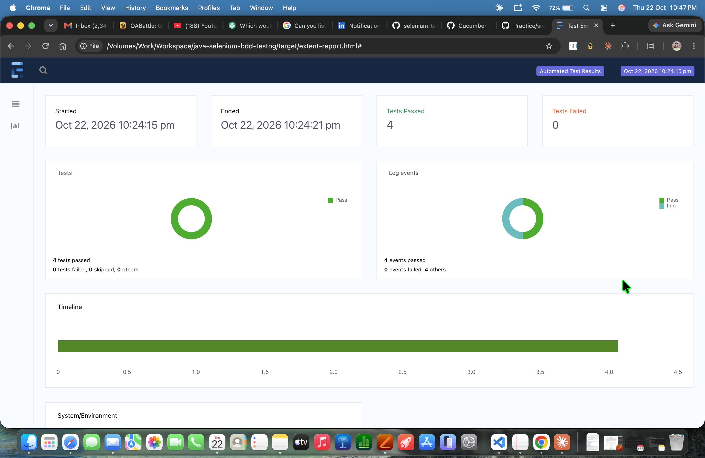

# Java Selenium BDD Test Automation Framework

A Java-based browser UI automation project that combines Selenium WebDriver, Cucumber/Gherkin, and TestNG. It demonstrates a small, layered test framework with Page Objects, Cucumber hooks, TestNG listeners, ExtentReports, logging, configuration properties, and Excel utilities.

## Project Dates

- **First commit available in this repository:** 2026-09-11
- **Latest recorded commit:** 2026-10-22
- **Project end date:** Not recorded; this repository appears to be ongoing.

These are Git history dates, not a claim about the exact date work began or the project’s completion date. Local uncommitted changes are not represented by the latest commit date.

## What It Tests

The current feature covers a basic practice-form workflow on `https://www.sreenidhirajakrishnan.com/practice`:

1. Open the application page and verify the destination URL.
2. Enter name, password, email, phone, and bio values.
3. Submit the form.
4. Verify the displayed confirmation message.

The scenario is a Cucumber `Scenario Outline` with four example data rows. The runner executes scenarios through TestNG’s data provider, configured for parallel execution.

## Technology and Dependencies

Java compiler target is **17**. The project has been run in an environment using a newer Java runtime; use a JDK compatible with the Maven compiler target and project dependencies.

| Dependency | Version | Purpose |
| --- | --- | --- |
| `io.cucumber:cucumber-picocontainer` | 7.34.8 | Constructor-based dependency injection for Cucumber glue |
| `io.cucumber:cucumber-java` | 7.34.8 | Cucumber Java hooks and step definitions |
| `io.cucumber:cucumber-testng` | 7.34.8 | Run Cucumber scenarios through TestNG |
| `org.testng:testng` | 7.10.2 | Test execution, data provider, and listener APIs |
| `org.seleniumhq.selenium:selenium-java` | 4.31.0 | Browser automation with Selenium WebDriver |
| `org.apache.poi:poi-ooxml` | 5.4.1 | Read and write Excel workbooks (`.xls` and `.xlsx`) |
| `com.aventstack:extentreports` | 5.1.2 | Interactive HTML execution report and screenshot media |

The table lists the direct dependencies declared in `pom.xml`; Maven also resolves their transitive dependencies. All direct dependencies currently have Maven `test` scope because this repository is a test automation project.

### Build Plugins

| Plugin | Version | Purpose |
| --- | --- | --- |
| `maven-surefire-plugin` | 3.3.0 | Runs the TestNG Cucumber runner during Maven’s `test` phase |
| `maven-compiler-plugin` | 3.13.0 | Compiles the project with the configured Java release |
| `maven-resources-plugin` | 3.3.1 | Copies test resources |
| `maven-clean-plugin` | 3.4.0 | Cleans generated build output |
| `maven-jar-plugin` | 3.4.2 | Packages a JAR when requested |
| `maven-install-plugin` | 3.1.2 | Installs a build artifact locally when requested |
| `maven-deploy-plugin` | 3.1.2 | Deploys a build artifact when configured |
| `maven-site-plugin` | 3.12.1 | Generates Maven site documentation when requested |
| `maven-project-info-reports-plugin` | 3.6.1 | Generates Maven project information reports |

The first four plugins are explicitly used/configured by the build; the remaining listed versions are pinned in `pluginManagement`.

## Prerequisites

- JDK 17 or later, with `JAVA_HOME` configured.
- Apache Maven installed and available as `mvn`.
- Google Chrome installed. Selenium Manager (bundled with Selenium) resolves the browser driver in the standard setup.
- Network access to the application under test and, on first execution, to Maven repositories for dependency downloads.

Check the local tools with:

```bash
java -version
mvn -version
```

## Run the Tests

Run the full configured suite from the project root:

```bash
mvn clean test
```

Run without cleaning generated output first:

```bash
mvn test
```

The Surefire configuration selects `com.example.runners.RunCucumberTest`. That runner points Cucumber to `src/test/resources/features`, uses `com.example` as the glue package, and registers the logging and Extent listeners.

To compile test sources without executing the browser tests:

```bash
mvn -DskipTests test-compile
```

## Reports and Logs

Generated files are written under `target/`:

| Output | Location | Contents |
| --- | --- | --- |
| Extent HTML report | `target/extent-report.html` | Test outcomes, system/environment details, browser information, and failure screenshots |
| Cucumber HTML report | `target/cucumber-reports.html` | Feature and scenario execution results |
| Cucumber JSON report | `target/cucumber-report.json` | Machine-readable Cucumber results |
| Surefire HTML report | `target/surefire-reports/index.html` | TestNG/Maven execution summary |
| Surefire XML report | `target/surefire-reports/TEST-com.example.runners.RunCucumberTest.xml` | Structured test results and captured output |
| Surefire text report | `target/surefire-reports/com.example.runners.RunCucumberTest.txt` | Concise pass/fail summary |
| Application test log | `target/test-execution.log` | Java Util Logging output from the TestNG listener; appended on ordinary runs |

`mvn clean test` deletes the existing `target/` directory first, including prior reports and logs. Use `mvn test` when you want the application log to continue appending to its previous contents.

Open `target/extent-report.html` in a browser and use the bar-chart icon in the left navigation to view the dashboard charts. The Spark report currently loads some display assets from external CDNs, so network access may be needed for all report styling and charts to render.

The Extent report includes Java runtime/vendor/target, operating system, Maven, dependency and selected Maven plugin versions. Browser name/version is populated from Selenium capabilities when the scenario hook starts a browser.

## Framework Layout

```text
src/test/java/com/example/
  hooks/           Cucumber scenario and suite lifecycle hooks
  listeners/       TestNG logging and Extent report listeners
  pageobjects/     Selenium page objects and shared wait behavior
  runners/         TestNG Cucumber runner and Cucumber options
  step_definitions/ Cucumber steps and shared test base
  utils/           Driver management, properties, Excel, logging, and reports
src/test/resources/
  config.properties
  features/        Gherkin feature files
```

## Framework Design Highlights

- **Readable BDD:** Gherkin feature scenarios express the workflow and its example data.
- **Page Object Model:** `BasicFormPage` owns locators and browser interactions; step definitions coordinate the user journey and assertions.
- **Browser lifecycle:** Cucumber hooks initialize and quit the browser. `DriverManager` uses a `ThreadLocal<WebDriver>` so concurrent TestNG scenario workers do not use the same driver instance.
- **Dependency injection:** Cucumber PicoContainer provides glue-class dependencies through constructors.
- **Test observability:** `LogListener` records lifecycle and exception events; `ExtentListener` records test status and attaches a screenshot when a scenario fails.
- **Configuration and data helpers:** `ConfigProperties` reads `config.properties`; `ExcelUtils` supports cell reads/writes for `.xls` and `.xlsx` files.

## Configuration

The current application URL is stored in `src/test/resources/config.properties`:

```properties
URL=https://www.sreenidhirajakrishnan.com/practice
```

The current feature file also contains the URL in its `Given` step. If the URL changes, update the feature and configuration consistently, or adapt the step definition to read the property so there is only one source of truth.

## Known Limitations and Next Improvements

- `ExcelUtils.getDataForTest` currently contains a developer-machine-specific workbook path. The general `readCell` and `writeCell` APIs accept a filename, but the sample data lookup method should be changed to accept a portable path or load a workbook from test resources before reuse on another machine.
- The Cucumber feature has four example rows, but broader assertions, negative cases, boundary validation, and API-level checks are not currently demonstrated.
- The browser version can be newer than the DevTools protocol support bundled with the pinned Selenium version. Selenium may emit a CDP compatibility warning; align Selenium/browser versions if DevTools features are needed.
- CI pipeline configuration, test result trend history, and cross-browser coverage are not included in the current repository.

## Candidate / Portfolio Summary

This repository can be presented as a hands-on framework project demonstrating Java UI automation, BDD scenario design, TestNG integration, maintainable page objects, browser lifecycle management, reporting, logging, and test-data utility work. When describing it professionally, distinguish personal project work from production experience and add measurable impact only when it can be substantiated.
